# TraceLens

**Debug your errors with AI, without leaking your secrets.**

Stack traces and logs are full of things that should never be pasted into a chatbot: database passwords, API keys, JWTs, customer emails, internal hostnames. TraceLens removes them **on your device**, triages the error locally, and only sends the **sanitized** trace to cloud Gemini when it needs a deeper root-cause analysis.

Built for the Firebase **#BuildHybridAI** hackathon with the **Firebase AI Logic Hybrid Inference SDK**, on **Web (Chrome + Gemini Nano)**, **Android (Gemini Nano via AICore)** and **iOS (Apple Foundation Models)**.

**Live demo:** https://tracelens-e8e9a.web.app (desktop Chrome recommended)

<p align="center">
  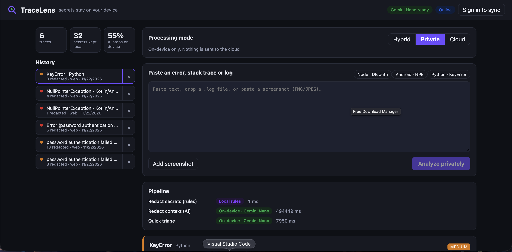
</p>
<p align="center"><sub>Web (Chrome + Gemini Nano)</sub></p>

<p align="center">
  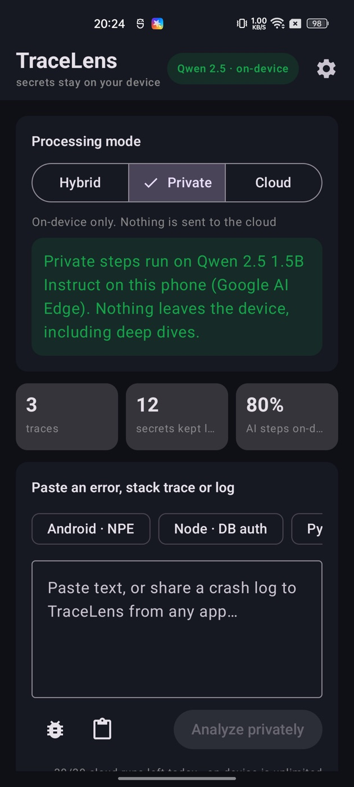
  &nbsp;&nbsp;&nbsp;
  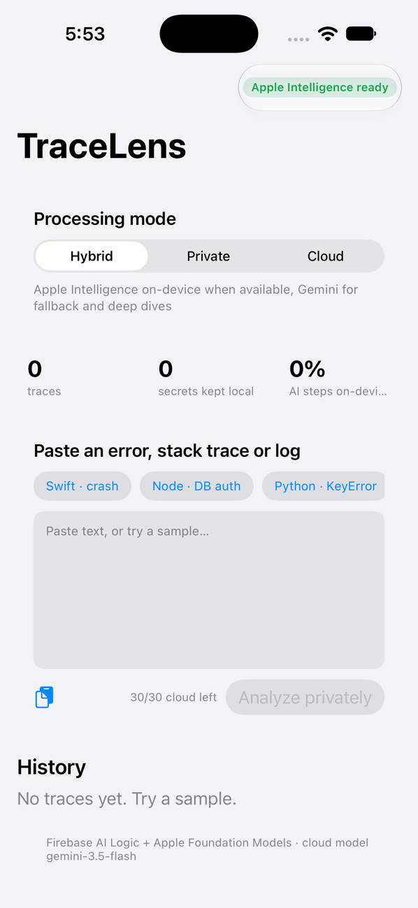
</p>
<p align="center"><sub>Android (Qwen 2.5 on the phone) &nbsp;·&nbsp; iOS</sub></p>

### Local AI on every platform

Private mode keeps every AI step off the cloud. Real runs: **Web** in Chrome on an 8 GB M1 Mac, **Android** on a Realme X50 Pro (no Gemini Nano) and **iOS** in the iPhone 18 Pro simulator.

**Web · Gemma 4 E2B running inside the browser (Google AI Edge, WebGPU)**: redaction 6.5 s · triage 4.0 s · deep dive 14 s, 100% on-device. It found the real bug: the data has `amountCents`, not `amount_cents`.

<p align="center">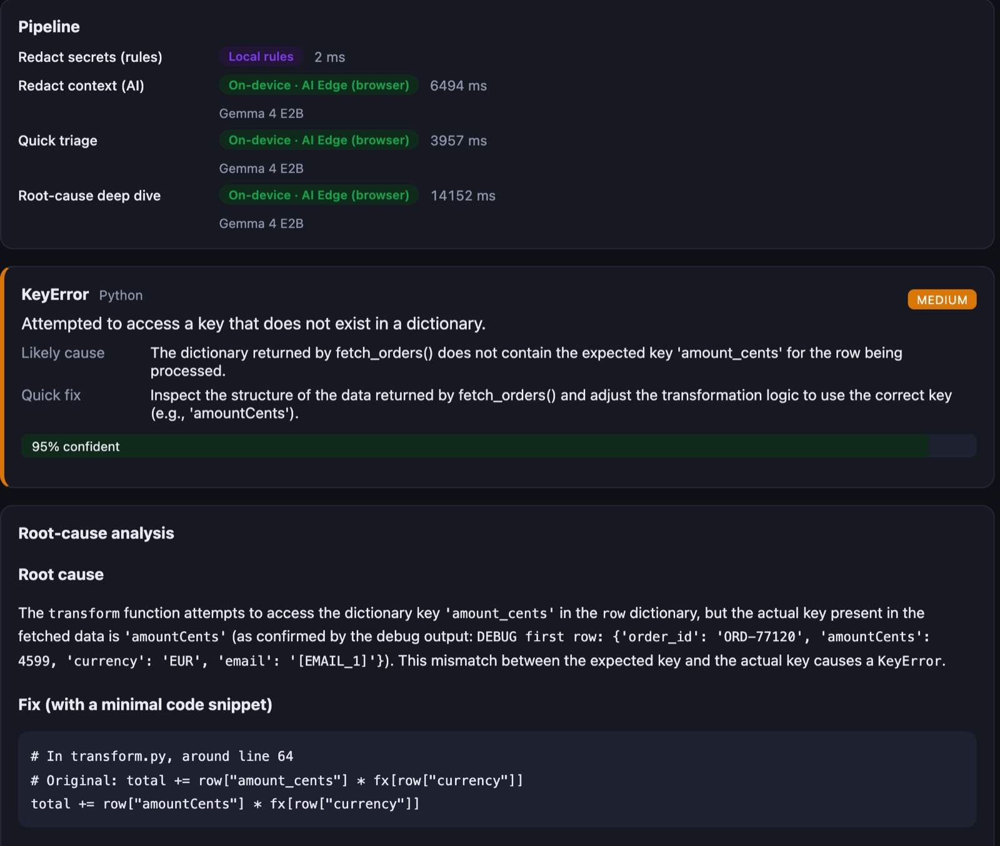</p>

| Android · Qwen 2.5 **on the phone** | Android · Llama 3.2 **on a network server** | iOS · Llama 3.2 **on a network server** | iOS · private deep dive |
|:---:|:---:|:---:|:---:|
| 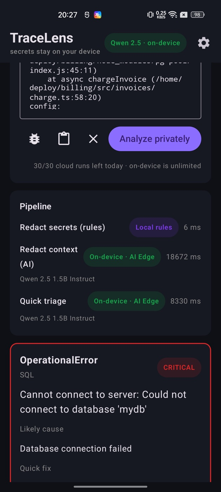 | 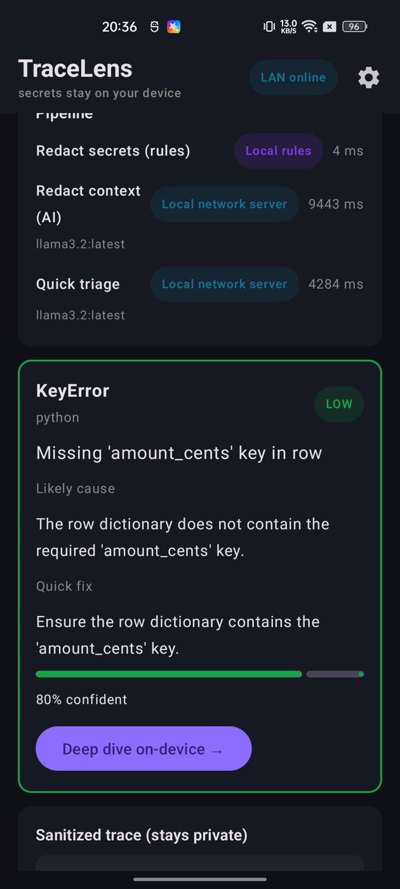 | 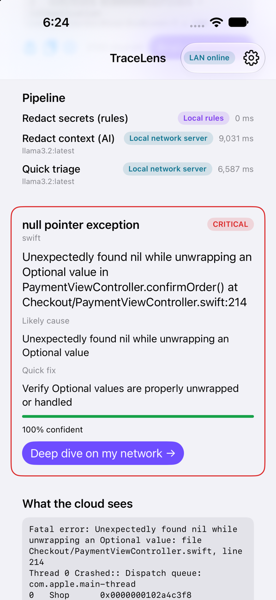 | 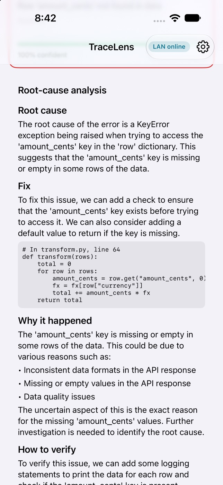 |
| redaction ~18 s · triage ~9 s | redaction 9.4 s · triage 4.3 s | redaction 9 s · triage 6.6 s | root cause + code fix |

*On a real iPhone 15 Pro or newer, iOS uses Apple Intelligence on-device; the Simulator can't run Apple's model, so the iOS shots use the network server.*

---

## Contents

1. [Why hybrid](#why-hybrid)
2. [Tour of the screen](#tour-of-the-screen-what-each-section-means)
3. [Try it in 2 minutes](#try-it-in-2-minutes)
4. [Set up Gemini Nano in Chrome](#set-up-gemini-nano-in-chrome)
5. [Bigger models on your local network](#bigger-models-on-your-local-network)
6. [Open models on the device (Google AI Edge)](#open-models-on-the-device-google-ai-edge)
7. [Debug your installed apps](#debug-your-installed-apps)
8. [Firebase setup](#firebase-setup-run-your-own-copy)
9. [Run & build each platform](#run--build-each-platform)
10. [How it works](#how-it-works)
11. [Abuse protection & cost caps](#abuse-protection--cost-caps)
12. [Limitations](#limitations)

---

## Why hybrid

| | On-device / local network | Cloud (Gemini) |
|---|---|---|
| Find contextual PII (names, internal hosts, customer IDs) | ✅ `ONLY_ON_DEVICE`, never falls back | ❌ by design |
| Read error screenshots (web) | ✅ `ONLY_ON_DEVICE` | only with explicit opt-in |
| Quick triage (structured JSON) | ✅ `PREFER_ON_DEVICE` | fallback when no local model or the trace is too long |
| Deep root-cause analysis + fix | ✅ on a local network server (Private mode) | ✅ `ONLY_IN_CLOUD`, streamed, sanitized input only |

- **Privacy:** raw logs never leave the device. Deterministic rules always run first, and the AI redaction pass is local-only. If it fails, TraceLens asks you to review before anything is sent.
- **Cost and latency:** most errors are triaged locally for free. The cloud is used only when local confidence is low or you ask for it.
- **Offline:** triage works without internet. History is cached by Firestore offline persistence.
- **Works everywhere:** devices without a local model fall back to cloud triage through the same SDK call, still on sanitized text only.

---

## Tour of the screen (what each section means)

| Section | What it shows |
|---|---|
| **Header pills** | `Gemini Nano ready` / `Apple Intelligence ready` / `No on-device AI` = local model status. `LAN server online/offline` = your network server. `Online/Offline` = internet. **⚙ Settings** opens the Settings page (one tab per engine). |
| **Processing mode** | **Hybrid**: local model first, cloud for fallback and deep dives. **Private**: nothing goes to the cloud. **Cloud**: for devices without a local model; secrets are still removed locally by rules. |
| **Stats** | Traces analyzed, **secrets kept local**, and **% of AI steps that ran on-device** (the hybrid payoff). |
| **Input** | Paste a trace, use a **sample**, drop a `.log` file, paste a **screenshot** (web), **share** text from any app (Android), import a crash file (🐞). Shows **cloud runs left today**. |
| **Pipeline** | Every step with **where it ran** and how long it took. |
| **Review before sending** | Appears when only rules redacted the text (no local model). **Highlight any text → Hide**, then **send**. |
| **Triage card** | Error type, severity, likely cause, quick fix, and a **confidence bar**. Low confidence auto-escalates to the deep dive. |
| **Root-cause analysis** | The streamed deep dive: root cause, a code fix, why it happened, how to verify, and how to prevent it. |
| **What the cloud sees / Kept on this device** | The exact sanitized text sent out, with `[PLACEHOLDERS]` highlighted, plus the list of hidden values (masked) and who caught each one: `rule`, `Gemini Nano` / `Apple Intelligence`, or `you`. In Private mode it's labelled *Sanitized trace (stays private)*. |
| **History** | Your sanitized traces, synced through Firestore and tagged `web` / `android` / `ios`. |

**Pipeline badge legend:** 🟣 **Local rules** (regex, instant) · 🟢 **On-device** (Gemini Nano / Apple Intelligence / **AI Edge** model on the phone) · 🔷 **Local network server** (your own machine) · 🔵 **Cloud · Gemini** · ⚪ **Skipped** (with the reason).

### Hiding things before you show or share a trace
1. Secrets matching known patterns (keys, tokens, passwords, emails, phones, IPs, names after labels like `customer=`) are replaced automatically, e.g. `[AWS_KEY_1]`.
2. The local model catches contextual items (people, internal hosts, customer IDs).
3. When no local model ran, the **Review** card lets you **select any text and press Hide**. It becomes `[HIDDEN_1]` everywhere.
4. Placeholders are stable (the same secret always gets the same placeholder), so the AI can still reason about the trace. The originals stay in memory on your device and are **never stored** in Firestore.

| Review & hide (web) | Result (web) |
|:---:|:---:|
| 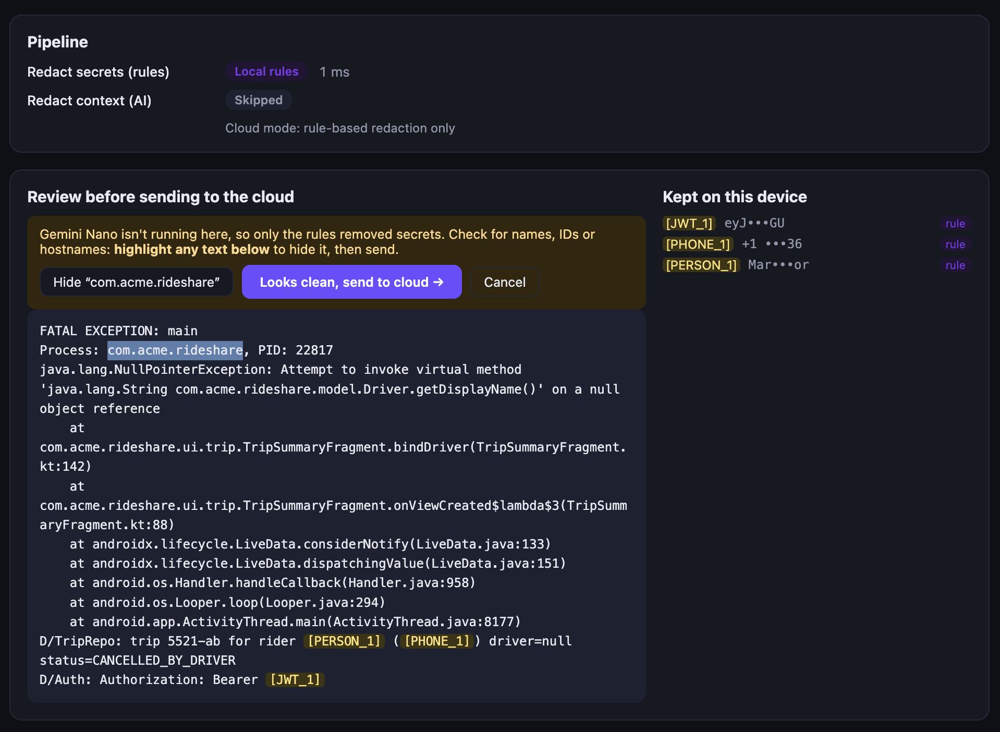 | 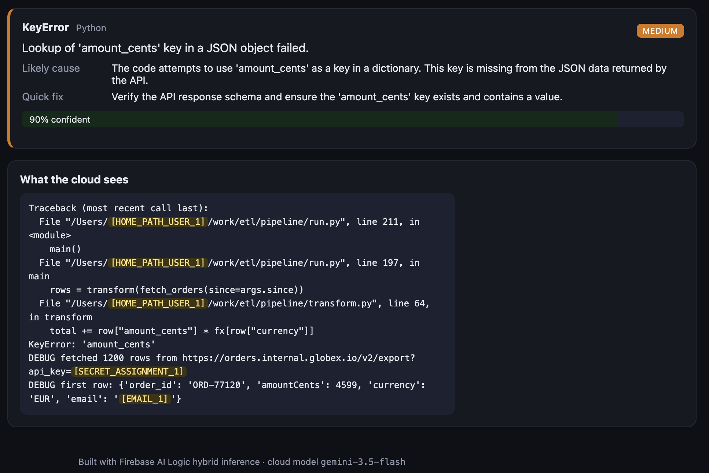 |

| Android: triage | Android: redacted trace | Android: crash import |
|:---:|:---:|:---:|
| 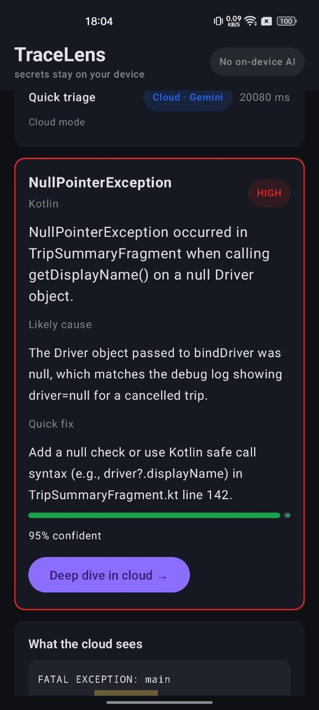 | 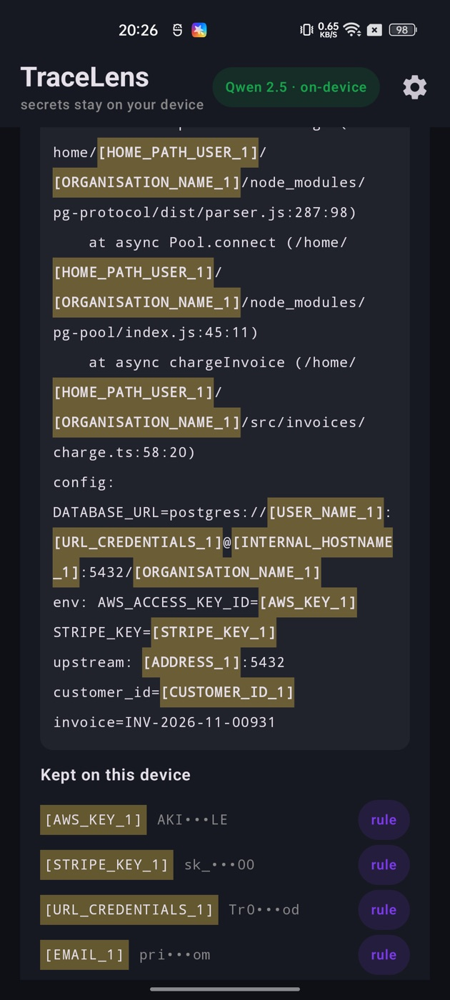 | 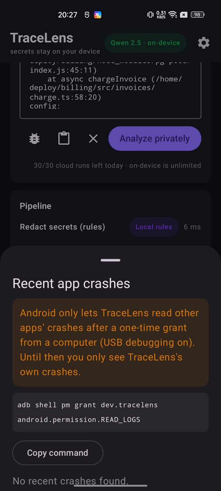 |

---

## Try it in 2 minutes

1. Open https://tracelens-e8e9a.web.app in desktop Chrome.
2. Click the **Node · DB auth** sample → **Analyze privately**.
3. Without Gemini Nano you'll get the **Review** card: highlight `svc_billing`, press **Hide**, then **send to cloud**.
4. Read the triage card, then press **Deep dive in cloud →**.
5. Optional: set up Gemini Nano (below) and repeat in **Private** mode. Every step goes green.

---

## Set up Gemini Nano in Chrome

**Requirements (Chrome's, not ours):** desktop Chrome **139+** on Windows 10/11, macOS 13+ or Linux · **22 GB free disk** on the drive with your Chrome profile (the model itself is about 4 GB) · a GPU with **more than 4 GB VRAM**, or **16 GB RAM** with 4+ cores · an **unmetered** connection for the one-time download.

**⚙ Settings** is its own page with one tab per engine: **Gemini Nano**, **Browser models** and **Network server** (`#/settings/nano`, `/browser`, `/network`). Each tab shows its requirements and setup, with **✓ In use** or **Use this engine**. The Gemini Nano tab checks each setup step live and has **Copy** buttons for every page. Web pages aren't allowed to open `chrome://` links themselves, so you paste them into the address bar.

| Step | Page | What to do |
|---|---|---|
| 1 | `chrome://flags/#prompt-api-for-gemini-nano-multimodal-input` | Set to **Enabled** |
| 2 | `chrome://flags/#optimization-guide-on-device-model` | Older Chrome only: **Enabled BypassPerfRequirement**. It's gone in newer versions, which is fine. |
| 3 | **Restart Chrome completely** | macOS ⌘Q / Windows: Exit. Closing the window is not enough. |
| 4 | TraceLens → **Set up on-device AI** → **I meet these, download** | Starts the about 4 GB download. It has to be a click; Chrome requires a user gesture. |
| 5 | Header shows **Gemini Nano ready** | Done. Private mode is now available. |

**Download stuck at 0%?**
- Free up disk space: Chrome refuses below 22 GB free. TraceLens warns after 30 s and stops by itself after 2 min.
- Open `chrome://components` → **Optimization Guide On Device Model** → **Check for update**.
- Open `chrome://on-device-internals` → **Model Status** / **Event Logs** to see the exact reason.
- Avoid phone hotspots and "Low Data Mode" networks (Chrome treats them as metered).
- Restart Chrome after changing anything.

**Too slow?** On low-end machines Gemini Nano can take minutes per request. TraceLens gives up after 45 s per chunk and falls back to the review step, or you can use a [bigger model on your network](#bigger-models-on-your-local-network) or **Cloud** mode.

---

## Bigger models on your local network

If your laptop or phone is slow, or can't run a local model at all, TraceLens can use a **more powerful computer on your Wi-Fi** instead. The data stays on your network, so it counts as private: it's allowed in Private mode and uses no cloud quota. Private mode then also runs the **deep dive** on that machine.

**On the powerful machine** (Mac/Windows/Linux with [Ollama](https://ollama.com)):
```bash
ollama pull qwen2.5-coder:7b                      # or any model from the table
OLLAMA_HOST=0.0.0.0 OLLAMA_ORIGINS=* ollama serve # listen on the network, allow the web app
```
**In TraceLens:** ⚙ Settings → **Bigger model on my network** → enter `http://<that-machine-ip>:11434` → **Test connection** → pick a model. The header shows **LAN server online/offline**. If the machine is off or unreachable, TraceLens says so instead of silently falling back.

| Model | Min RAM on the server | Good for |
|---|---|---|
| `llama3.2:3b` | 4 GB | fast triage on laptops |
| `gemma3:4b` | 6 GB | good all-rounder |
| `qwen2.5-coder:7b` | 8 GB | best code reasoning per GB |
| `gemma3:12b` | 12 GB | stronger root-cause analysis |
| `qwen2.5-coder:32b` | 24 GB | near-cloud quality (desktop GPU / 32 GB Mac) |

**Memory saver toggle ("stream weights from disk"):** memory-maps the model file (`use_mmap`) so only the layers being used sit in RAM while the rest stays on disk. It also uses a smaller context window and unloads the model after 1 minute idle. That lets a bigger model run on a machine with less RAM, at the cost of a slower first answer. *(Gemini Nano and Apple Intelligence manage their own memory inside Chrome / Android / iOS, so this toggle applies to network models only.)*

**Notes:**
- **Web, hosted site:** browsers block `http://` LAN addresses from an `https://` page. Use `http://localhost:11434` when Ollama runs on the same computer, put the server behind HTTPS (e.g. `tailscale serve`, Caddy), or run TraceLens locally (`npm run dev`).
- **Android:** cleartext HTTP is allowed so it can reach the server (Firebase traffic stays HTTPS).
- **iOS:** asks for **Local Network** permission the first time.

<p>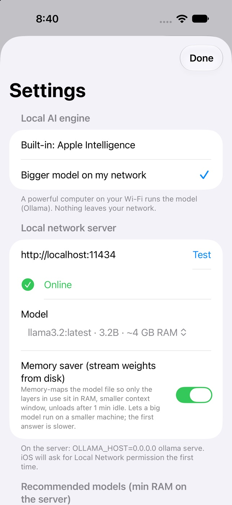</p>

**Android:** besides network models, ⚙ Settings lets you pick the Gemini Nano build: **Stable** (default), **Fast** (smaller, `PREVIEW_FAST`) or **Latest** (larger, `PREVIEW`). The preview builds need the AICore developer preview.

---

## Open models on the device (Google AI Edge)

Gemini Nano isn't everywhere, and on low-end machines it can be very slow (8 min per request on an 8 GB M1). TraceLens can instead **download an open model and run it on the device itself** with Google's **MediaPipe LLM Inference** runtime, the same one the *Google AI Edge Gallery* app uses.

### Web: models in the browser (WebGPU)

⚙ Settings → **Browser models** tab → **Download** → **Use this engine**. The model is stored in the browser's private storage (OPFS), so it downloads once, and it runs on your GPU.

| Model | Download | Needs | Access |
|---|---|---|---|
| Gemma 3 270M | 0.28 GB | any WebGPU device | Hugging Face token |
| Gemma 3 1B (int4) | 0.7 GB | ~4 GB memory | Hugging Face token |
| **Gemma 4 E2B** (recommended) | 2.0 GB | ~6 GB memory | free |
| Gemma 4 E4B | 3.0 GB | ~8 GB+ memory | free |

Requires WebGPU: Chrome / Edge 121+ or Safari 26+. Measured on an 8 GB M1 MacBook Pro with Gemma 4 E2B: first load ~40 s, then redaction ~7 s, triage ~4 s, deep dive ~14 s.

| Browser models tab | Network server tab | Gemini Nano tab |
|:---:|:---:|:---:|
| 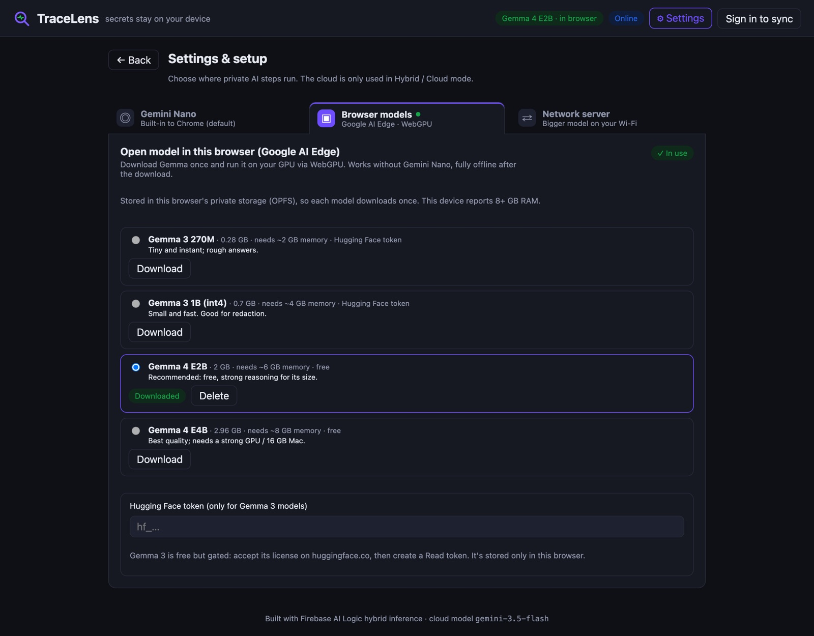 | 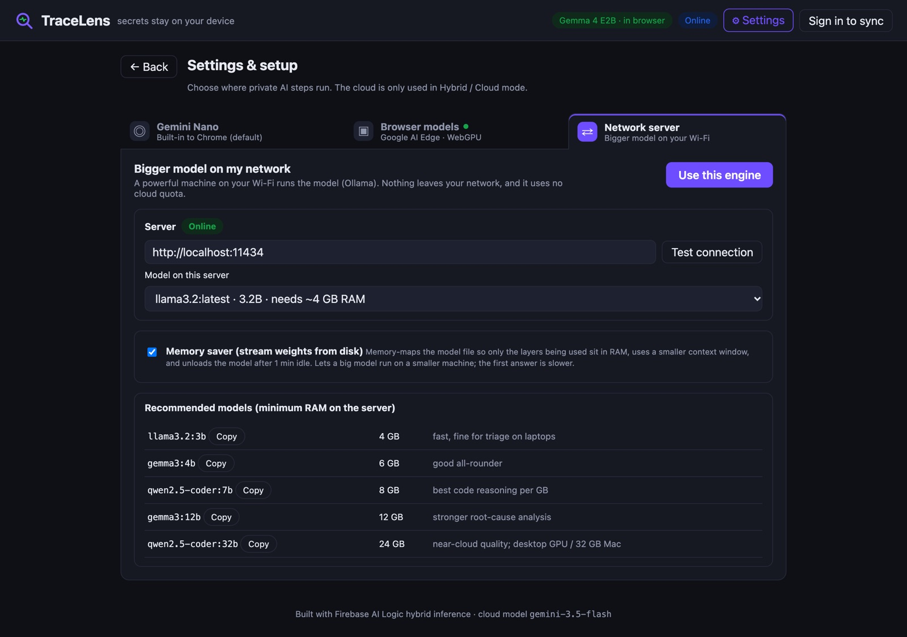 | 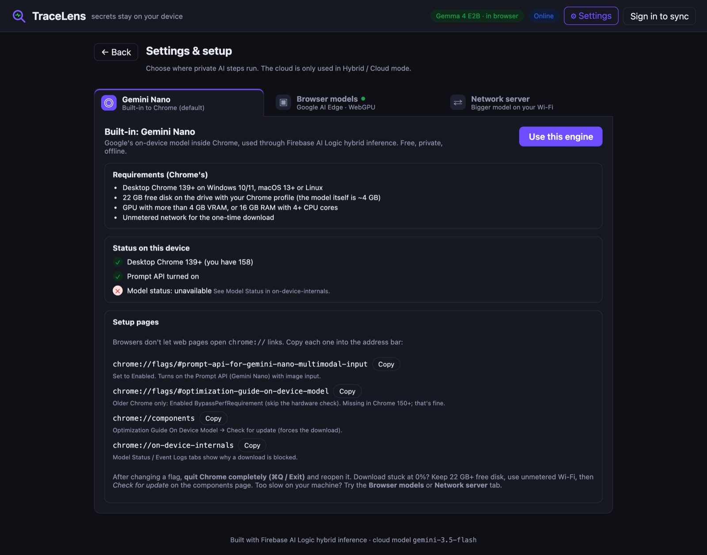 |

### Android: models on the phone

Most phones don't have Gemini Nano (it needs AICore: Pixel 9+, Galaxy S24+ and similar). TraceLens can instead **download an open model and run it on the phone itself**, using Google's **MediaPipe LLM Inference** runtime, the same one the *Google AI Edge Gallery* app uses. Private mode then works on almost any recent Android phone, offline, with nothing leaving the device.

⚙ Settings → **On-device model (Google AI Edge)** → **Download** a model → it becomes the private engine. The header shows e.g. **Qwen 2.5 · on-device**.

| Model | Download | Min phone RAM | Access |
|---|---|---|---|
| Gemma 3 1B (int4) | 0.55 GB | 3 GB | Hugging Face token |
| **Qwen 2.5 1.5B Instruct** (recommended) | 1.6 GB | 4 GB | free |
| Gemma 3n E2B (int4), AI Edge Gallery's headline model | 3.1 GB | 6 GB | Hugging Face token |
| Phi-4-mini Instruct | 3.9 GB | 8 GB | free |

- The app shows the phone's RAM and warns when a model needs more.
- Downloads are resumable (Pause / Download again), and **Delete** frees the space.
- Gemma models are free but gated: accept the license on huggingface.co, create a *Read* token, and paste it in Settings. It's stored only on the phone.
- The model runs on the GPU when possible and falls back to the CPU.
- **Measured on a Realme X50 Pro (Snapdragon 865, 8 GB)** with Qwen 2.5 1.5B: about 18 s for contextual redaction, about 9 s for triage. It caught the username, internal hostname, organisation and customer ID that the rules missed.
- **Quality note:** 1–2B models give useful triage but can invent details (e.g. a database name). Use **Hybrid** for a cloud deep dive, or a bigger model (Gemma 3n, or a [network server](#bigger-models-on-your-local-network)), when it matters.
- *Why not Firebase AI Logic here?* AI Logic's on-device path is Gemini Nano. AI Edge is an extra local engine for phones without Nano. Cloud calls still go through Firebase AI Logic with App Check.

| Model picker | Private mode on Qwen 2.5 | Network server (Android) | Private deep dive on the network |
|:---:|:---:|:---:|:---:|
| 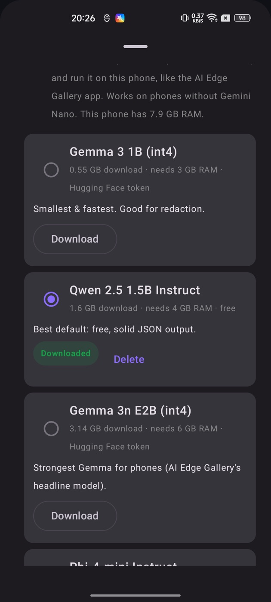 |  | 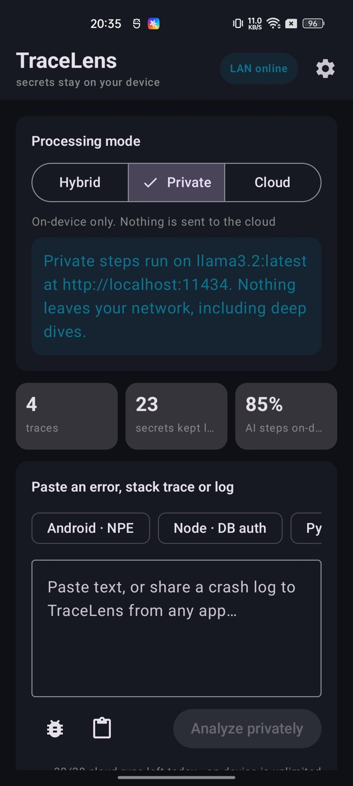 | 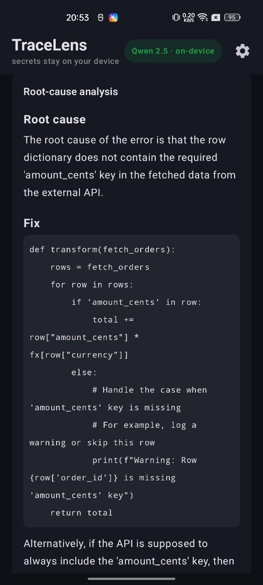 |

---

## Debug your installed apps

**Android:** tap 🐞 **Import crashes from installed apps** to list recent crashes of **any app** on the phone, from the system crash log. Tap one and it's loaded, redacted and triaged like any trace. Android only allows this after a **one-time grant from a computer** (USB debugging on):
```bash
adb shell pm grant dev.tracelens android.permission.READ_LOGS
```
Without the grant you only see TraceLens's own crashes; the app shows the command with a Copy button. You can also **share** any crash text to TraceLens from another app.

> **Realme / OPPO / OnePlus:** the grant fails with `SecurityException … GRANT_RUNTIME_PERMISSIONS` until you enable **Developer options → Disable permission monitoring**. **Xiaomi:** enable **USB debugging (Security settings)**.

**iOS:** Apple's sandbox doesn't let apps read other apps' crash logs. Export a crash from **Settings → Privacy & Security → Analytics Data** (or Xcode → Devices), then tap 🐞 to import the `.ips` / `.crash` / `.log` file.

**Web:** drop a `.log` file or paste a screenshot of an error.

---

## Firebase setup (run your own copy)

One Firebase project serves all three apps.

1. **Create a project** at https://console.firebase.google.com and add the apps you need:
   - **Web app**, then copy the config into `web/.env` (see `web/.env.example`).
   - **Android app** with package `dev.tracelens`, then put `google-services.json` in `android/app/`.
   - **iOS app** with bundle ID `dev.tracelens.ios`, then put `GoogleService-Info.plist` in `ios/TraceLens/`.
   - All three config files are git-ignored.
2. **AI Logic** → Get started → **Gemini Developer API** (works on the free Spark plan).
3. **App Check** (required by AI Logic):
   - **Web:** create a **reCAPTCHA Enterprise** *Website* key, **in the same Google Cloud project as Firebase** (check the project picker!), with **no checkbox challenge**. Add the domains `localhost`, `<project>.web.app` and `<project>.firebaseapp.com`. Enable the **reCAPTCHA Enterprise API** in that project. Register the key under App Check → Apps → web app, and put it in `VITE_RECAPTCHA_ENTERPRISE_KEY`.
   - **Android:** Play Integrity (release) / debug provider (debug builds).
   - **iOS:** App Attest (release) / debug provider (debug & Simulator).
   - **Debug tokens:** generate one, add it in App Check → Apps → ⋮ → *Manage debug tokens* (or `firebase appcheck:debugtokens:create <token> --app <app-id>`), and set it in `VITE_APPCHECK_DEBUG_TOKEN` (web, local dev only; never deployed), logcat (Android) or `FIRAAppCheckDebugToken` (iOS scheme environment).
   - Then set **Firebase AI Logic** to **Enforced** on the App Check **APIs** tab.
   - *Symptom of a wrong key project:* `401 App Check token is invalid`.
4. **Authentication** → Sign-in method → enable **Anonymous** (and **Google** for cross-device sync).
5. **Firestore** → create the database, then deploy the rules and the Remote Config template:
   ```bash
   firebase use <project-id>
   firebase deploy --only firestore:rules,remoteconfig
   ```
6. **Remote Config** knobs (no redeploy needed): `cloud_model` (default `gemini-3.5-flash`), `escalate_below_confidence` (0.7), `max_on_device_chars` (24000), `auto_escalate` (true).

---

## Run & build each platform

### Web (Chrome) · [web/](web/)
```bash
cd web
cp .env.example .env     # fill in config, reCAPTCHA key, optional debug token
npm install
npm run dev              # http://localhost:5173
npm run build && cd .. && firebase deploy --only hosting
```
Production builds never contain the App Check debug token (`web/.env.production` blanks it).

### Android (Kotlin, Jetpack Compose) · [android/](android/)
Requirements: JDK 17, Android SDK 37.2, minSdk 26.
```bash
cd android
./gradlew installDebug                     # debug build on a connected phone
./gradlew assembleRelease bundleRelease    # signed release APK + AAB (see "Release signing")
```
- **First launch:** logcat prints the App Check debug token. Register it (see Firebase setup).
- **Gemini Nano:** runs on AICore devices (Pixel 9+, Galaxy S24+ and similar). Other phones use Cloud or a network model.
- **Release signing:** create `android/keystore.properties` with `storeFile`, `storePassword`, `keyAlias` and `keyPassword` (git-ignored). Release builds use **Play Integrity** for App Check, which works once the app is distributed through Google Play (e.g. internal testing) and its SHA-256 is registered in Firebase.

### iOS (Swift, SwiftUI) · [ios/](ios/)
Requirements: Xcode 27, iOS 27 SDK, [XcodeGen](https://github.com/yonaskolb/XcodeGen).
```bash
cd ios
xcodegen generate && open TraceLens.xcodeproj   # then Run on an iPhone or simulator
```
- **On-device AI:** needs an iPhone 15 Pro or newer with Apple Intelligence on. The Simulator reports the model as available but refuses inference, so TraceLens treats the Simulator as having no on-device AI and uses Gemini or a network model.
- **Release / TestFlight:** set your Team in Signing & Capabilities, add the **App Attest** capability, then Product → Archive. This requires a paid Apple Developer account.

---

## How it works

```
input (text / .log / screenshot / shared crash)
  │
  ├─ 1. redact      regex rules                       local, instant, always
  │                 contextual PII                    on-device or LAN model, never cloud
  │                 (failed / unavailable)            → user reviews & hides before cloud
  ├─ 2. triage      type, cause, fix, confidence      on-device → LAN → cloud fallback
  ├─ 3. route       confidence < threshold (Remote Config) → escalate
  └─ 4. deep dive   root cause + code fix             cloud (Hybrid) or LAN (Private), streamed
```

| Platform | On-device model | How hybrid is wired |
|---|---|---|
| **Web** | Gemini Nano (Chrome Prompt API) | `getGenerativeModel(ai, { mode: InferenceMode.ONLY_ON_DEVICE / PREFER_ON_DEVICE / ONLY_IN_CLOUD, onDeviceParams, inCloudParams })`; `response.inferenceSource` says where each step ran |
| **Android** | Gemini Nano (AICore, `firebase-ai-ondevice`) | `generativeModel(..., onDeviceConfig = OnDeviceConfig(mode, modelOption))`; `FirebaseAIOnDevice.checkStatus()/download()` |
| **iOS** | Apple Intelligence (Foundation Models) | Apple's `LanguageModelSession` with either `SystemLanguageModel.default` or Firebase's `ai.geminiLanguageModel(name:)` (same API, `@Generable` structured output) |

| Firebase product | Use |
|---|---|
| **AI Logic** | Hybrid inference on all three platforms |
| **App Check** | reCAPTCHA Enterprise / Play Integrity / App Attest (debug providers for development) |
| **Authentication** | Anonymous on first launch; Google to sync across devices |
| **Firestore** | Sanitized history (offline cache) + rate-limit counters, locked down by [firestore.rules](firestore.rules) |
| **Remote Config** | Cloud model and routing thresholds |
| **Hosting** | Live web demo |

**Code map:**

| Area | Web | Android | iOS |
|---|---|---|---|
| Hybrid pipeline | [pipeline.ts](web/src/lib/pipeline.ts) | [Pipeline.kt](android/app/src/main/java/dev/tracelens/Pipeline.kt) | [Pipeline.swift](ios/TraceLens/Pipeline.swift) |
| Redaction rules | [redact.ts](web/src/lib/redact.ts) | [Redactor.kt](android/app/src/main/java/dev/tracelens/Redactor.kt) | [Redactor.swift](ios/TraceLens/Redactor.swift) |
| Local network engine | [local.ts](web/src/lib/local.ts) | [Lan.kt](android/app/src/main/java/dev/tracelens/Lan.kt) | [Lan.swift](ios/TraceLens/Lan.swift) |
| Open models on device (AI Edge) | [edge.ts](web/src/lib/edge.ts) | [Edge.kt](android/app/src/main/java/dev/tracelens/Edge.kt) | — |
| Settings page (tabs) | [SettingsPage.tsx](web/src/components/SettingsPage.tsx) | Settings sheet | Settings sheet |
| Rate limiting | [quota.ts](web/src/lib/quota.ts) | [Quota.kt](android/app/src/main/java/dev/tracelens/Quota.kt) | [Store.swift](ios/TraceLens/Store.swift) |
| Installed-app crashes | — | [Crashes.kt](android/app/src/main/java/dev/tracelens/Crashes.kt) | file import |

---

## Abuse protection & cost caps

Cloud calls are rate-limited by **Firestore security rules**, so the limits hold even against a modified client:

- **30 cloud AI calls per user per day** and **300 per day for the whole app** (about 9k/month, under reCAPTCHA Enterprise's 10k free assessments).
- Before every cloud call, the client must bump its own counter and the global counter in one transaction. The rules check that the day comes from the server clock, that each counter goes up by exactly +1, and that the limits hold. Rule tests cover skipping ahead, resetting to yesterday, bumping only one counter, writing someone else's counter and the 31st call: all are rejected.
- **On-device and local-network calls are free and never counted.**
- App Check tokens are fetched lazily (no token on page load), so visits that don't use AI cost no reCAPTCHA assessment.
- The project runs on the free **Spark** plan, so it can't be billed.

---

## Limitations

- On-device model availability is decided by Chrome / AICore / Apple, not by the app. TraceLens detects it and falls back.
- Gemini Nano and Apple Intelligence memory usage can't be controlled by apps. The memory-saver toggle applies to local-network models.
- Web pages can't open `chrome://` pages or reach `http://` LAN servers from HTTPS (browser security). The app explains the workaround.
- Reading other apps' crashes needs a one-time `adb` grant on Android (plus an OEM setting on Realme/OPPO/Xiaomi) and isn't possible on iOS.
- Small on-phone models (1–2B) can invent details; treat their triage as a first guess.

## License

[Apache 2.0](LICENSE)
